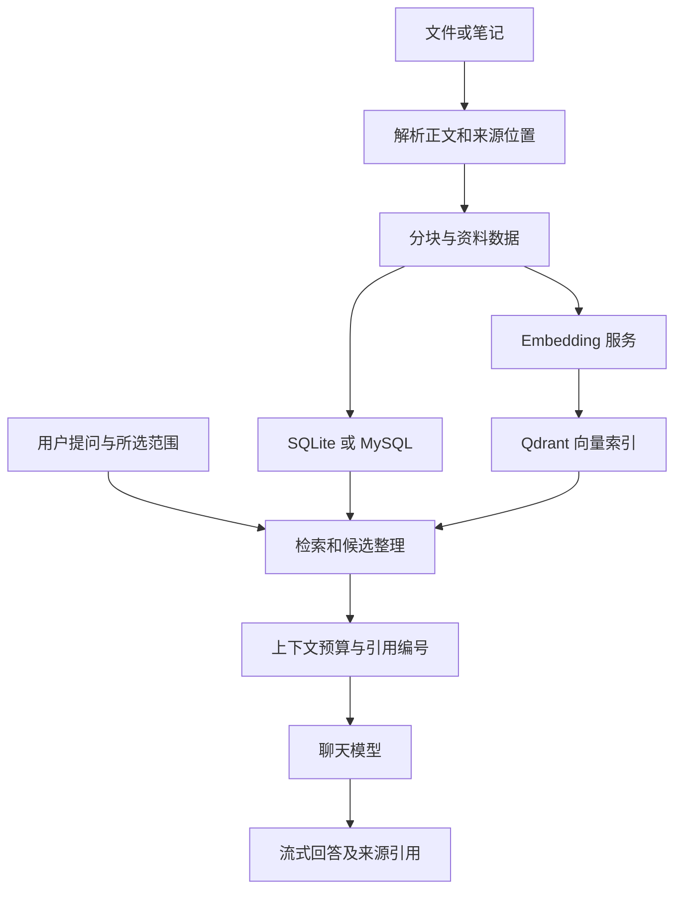

# 知澜架构说明

知澜是本地优先的知识库桌面应用。Windows 桌面窗口展示前端页面，同一进程启动本地 HTTP 服务，后端负责资料解析、索引、检索、对话与工具执行。数据默认落在本机；配置远程模型服务或联网工具后，相关请求会访问相应服务。

## 组件与职责

| 组件 | 主要职责 |
|---|---|
| `client/` | 单实例检查、数据迁移、选择端口、启动本地服务和打开 pywebview 窗口 |
| `frontend/` | React/TypeScript 界面、资料与知识库操作、模型设置、流式回答和引用展示 |
| `backend/main.py` | FastAPI 生命周期、API 注册、应用日志与前端静态资源服务 |
| `backend/app/pipeline/` | 文件解析、正文与来源位置保存、分块和索引构建 |
| `backend/app/retrieval/`、`backend/app/search/`、`backend/app/routing/` | 检索、资料范围选择、候选合并及查询路由 |
| `backend/app/generation/` | 回答上下文、模型请求、引用与生成状态处理 |
| `backend/app/agent/` | 工具装配、执行、时间预算与 MCP 接入 |
| `backend/app/session/`、`backend/app/cache/` | 会话、记忆与缓存处理 |
| `backend/app/system/` | 离线模型包校验与导入 |
| `backend/app/db/`、`backend/app/vector/` | 关系数据及向量存储适配 |

前端只使用后端 API；模型凭据由本机配置保存，公共设置响应只返回是否已配置密钥，不返回密钥正文。

## 资料到回答的数据流

PDF 优先提取文本层；扫描文档和图片 OCR 依赖可用的解析运行时与模型。Office 文件通过对应解析库处理。正文、页码及其他来源位置供后续引用使用，但解析与来源定位存在误差，最终引用需要对照原文件。

索引构建保存模型身份和构建状态，失败时保留已有可用版本。Embedding 请求失败不会把假向量当作成功结果；资料已经解析完成，也可能尚未成功向量化。

0.1.6 的图谱相似边在构建发布及重建索引收尾读取已有向量，生成同一知识库文档之间的 `kind="similar"` 边，保存在迁移 `0011` 新增的 `document_similarity_edges` 表。硬删除清除相关边，维护脚本可补算历史资料。该链路不请求模型，边仅用于图谱展示，不参与检索及回答；相似度不等于事实关系，真实选边质量未达计划线。

图谱读取相似边时检查两端文档及有效构建；派生计数增加 `similar_links`。前端按边类型控制显示，并按当前可见边重新计算孤立文档数。`GRAPHLINK_ENABLE=false` 时维护和读取在碰新表前返回；总开关默认开启，具体配置及补算步骤见 [配置说明](CONFIGURATION.md#图谱自动连线)。

检索在当前知识库和资料范围内收集候选，再整理上下文和引用编号。回答可以走普通检索生成或带工具的 Agent 路径。模型输出、工具观察和最终回答状态分别处理，错误、取消与截断不应当作正常成功。

## 本地数据与运行环境

源码快速开始采用 **SQLite + 本地 Qdrant**。SQLite 保存资料、笔记、关系与会话等数据；Qdrant 保存向量。本地 Qdrant 通过进程内共享客户端管理生命周期，同一目录只允许一个进程使用。

后端保留 MySQL 与 Qdrant 服务端配置；这些方式需要自行准备服务和独立验证部署条件。Redis 功能由进程内兼容层承担，快速开始不要求外部 Redis。兼容层在进程退出后不会提供外部 Redis 的持久化或多进程共享能力。

桌面服务只绑定本机回环地址。启动器会选择可用端口，窗口加载该地址。前端构建资源与数据位置分开解析：源码运行时使用仓库目录；Windows 成品运行时使用打包资源，配置、资料、模型和日志默认保存在安装目录。解析模型 HOME 可以由系统环境变量覆盖，模型导入目标以面板实际显示为准。

`.env` 是本机配置，设置页会保存其中可编辑的模型服务和角色绑定。模型服务注册表及聊天、Embedding、视觉角色分别配置；新增或更新服务后仍需明确绑定角色。更换 Embedding 模型或维度需要重建相应索引。

## 可选工具与数据边界

文件工具需要设置工作区根目录，并受路径边界和敏感目录规则约束。设置根目录可启用只读文件工具；写入另外需要有效的专用确认机制，当前默认配置与界面没有接入完整写入审批。联网工具默认关闭；MCP 使用包许可和 HTTP 外发许可。外部服务是否安全、是否具备实际权限，仍取决于用户选择的服务和本机环境。

MCP 发现失败会写应用日志，界面尚未展示全部原因。联网设置中的部分键只能修改 `.env` 并重启，界面不完整反映其状态。应用日志提供模式脱敏与轮转，不能替代发布前对日志内容的人为核查。

## 交付与验证边界

Windows 打包使用 PyInstaller 和安装器工具，构建入口、依赖锁定清单、模型清单与许可证收集工具在 `tools/packaging/`。离线模型导入验证预定义文件清单、长度和 SHA256；相同文件可以跳过，冲突文件拒绝覆盖。包后部出错时前部已写入的文件可能保留，导入不是整包原子事务。

源码的基本依赖清单不包含 OCR 的完整解析运行时。Windows 成品使用独立构建环境，二者的依赖用途不同。

工程与安装检查不等同于答案质量验收。现有模型复核仍发现事实和引用错误；实体增强检索、相似缓存及若干部署场景没有充分生产验证，默认关闭的能力不会因构建成功自动启用。

使用与配置入口见 [README](README.md)、[使用说明](USAGE.md) 和 [配置说明](CONFIGURATION.md)。
